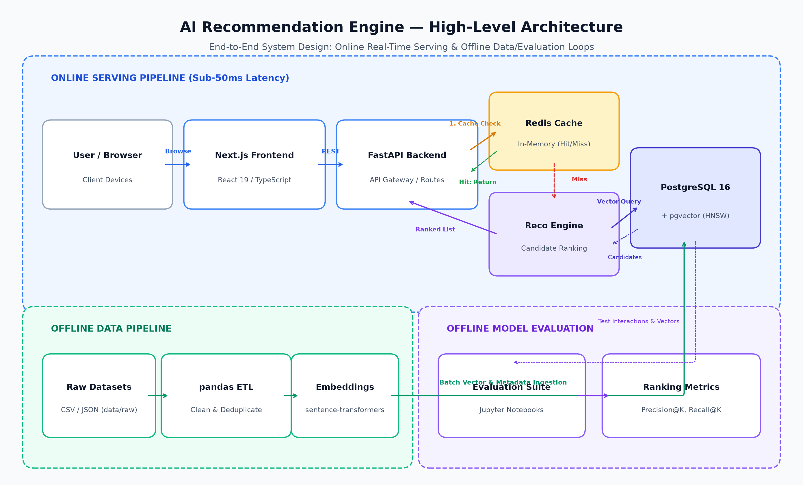

**Status:** Phase 1 (Day 1). Development environment initialized, backend and frontend scaffolded.
# AI Recommendation Engine

An end-to-end AI-powered Recommendation Engine designed to deliver personalized content and product recommendations in real time. The platform integrates a modern Next.js frontend with a high-performance Python FastAPI backend, leveraging PostgreSQL with pgvector for efficient vector similarity searches, Redis for low-latency caching, and machine learning pipelines built using pandas and scikit-learn.

## Current Status (Phase 1 — Day 7)

- **Environment:** Python 3.12 (`backend/venv`), Node.js v20.18.0 (`frontend/`), Git 2.55.0 configured. Docker Engine is pending BIOS virtualization, so local development uses SQLite via SQLAlchemy.
- **Working Features:**
  - MovieLens `ml-latest-small` cleaned (`9,742` movies, `100,836` ratings) via `backend/app/services/data_loader.py`
  - FastAPI endpoints: `GET /`, `GET /items`, `GET /items/{item_id}`, `GET /recommendations/popular`, `POST /ratings`
  - Next.js UI at `http://localhost:3000` with **Popular Right Now**, paginated **Movie Catalog**, and **1–5 Star Rating** buttons
- **Progress & Demo Docs:** See [`docs/progress-review.md`](docs/progress-review.md) and [`docs/demo-script.md`](docs/demo-script.md).

---

## Project Overview

The AI Recommendation Engine addresses the cold-start and real-time retrieval challenges in modern web platforms. By combining dense vector similarity searches (semantic embeddings via pgvector) with collaborative/content-based filtering and high-speed in-memory caching via Redis, the engine delivers hyper-personalized recommendations at scale with sub-50ms latency.

---

## Tech Stack

- **Frontend**: Next.js 16 (React 19, TypeScript, Tailwind CSS, App Router)
- **Backend**: FastAPI (Python 3.12, Uvicorn)
- **Machine Learning & Data**: pandas, scikit-learn, Jupyter, sentence-transformers
- **Vector Database**: PostgreSQL 16 with pgvector extension (`pgvector/pgvector:pg16`)
- **In-Memory Cache**: Redis (`redis:7`)
- **Containerization**: Docker & Docker Compose

---

## Project Structure
**Status:** Phase 1 (Day 1). Development environment initialized, backend and frontend scaffolded.

```text
recommendation-engine/
├── backend/
│   ├── app/                 # FastAPI application modules
│   │   ├── api/             # API route endpoints and routers
│   │   ├── core/            # Configuration and application settings
│   │   ├── models/          # Pydantic schemas and database models
│   │   └── services/        # Recommendation engine & vector logic
│   ├── tests/               # Backend unit and integration tests
│   ├── venv/                # Python virtual environment (ignored in git)
│   ├── main.py              # Application entry point & routes
│   └── requirements.txt     # Python backend dependencies
├── frontend/
│   ├── src/                 # Next.js source code (App Router)
│   │   ├── app/             # Application routes and pages
│   │   ├── components/      # Reusable UI components
│   │   └── lib/             # API client utilities and helper functions
│   ├── public/              # Static assets
│   ├── package.json         # Node.js dependencies and scripts
│   └── tsconfig.json        # TypeScript configuration
├── data/                    # Dataset storage
│   ├── raw/                 # Raw dataset files (ignored in git)
│   └── processed/           # Cleaned datasets and vector caches
├── notebooks/               # Jupyter notebooks for data analysis & modeling
├── db/                      # Database migration scripts & schemas
├── docs/                    # Architecture diagrams & project documentation
├── docker-compose.yml       # Multi-container setup for pgvector and Redis
├── .env.example             # Template for required environment variables
├── .gitignore               # Root git ignore specification
└── README.md                # Project documentation
```

For full directory documentation, see [`docs/folder-structure.md`](docs/folder-structure.md).

---

## System Modules

The platform is designed around 7 decoupled modules (detailed in [`docs/modules.md`](docs/modules.md)):
1. **Frontend UI**: Responsive Next.js application delivering catalog browsing, feed rendering, and click event streaming.
2. **Backend API**: FastAPI gateway managing request validation, security, and cache orchestration.
3. **Recommendation Engine**: Computes similarity scores, candidate ranking, and business rule filtering.
4. **Data Pipeline**: Ingests, cleans, normalizes raw datasets and generates dense vector embeddings.
5. **Database (PostgreSQL + pgvector)**: Persistent datastore for relational entities and high-dimensional vector search.
6. **Cache (Redis)**: Low-latency key-value store caching frequent recommendation feeds with TTL invalidation.
7. **Evaluation Module**: Offline benchmarking suite computing Precision@K, Recall@K, and ranking quality.

---

## Architecture & Data Flow

The system features two interconnected data loops: a real-time online inference pipeline optimized for low latency, and an offline pipeline for ETL and evaluation.



Detailed architectural specifications and flow descriptions are available in [`docs/architecture.md`](docs/architecture.md).

---

## Development Plan

- **Phase 1: Environment & Architecture (Current)**
  - Scaffold project workspace, install dependencies, and configure Git repository.
  - Define system modularity, folder structure, and architecture specifications.
- **Phase 2: Data Pipeline & Vector Database**
  - Ingest raw dataset into `data/raw/` and clean features with `pandas`.
  - Provision PostgreSQL with `pgvector` extension and define schema migrations.
  - Generate embeddings using `sentence-transformers` and build HNSW vector index.
- **Phase 3: Recommendation Engine & Redis Caching**
  - Implement similarity scoring and candidate retrieval in `backend/app/services/`.
  - Integrate Redis caching layer (`hit` returns in <5ms; `miss` computes and warms cache).
  - Expose REST API endpoints under `backend/app/api/`.
- **Phase 4: Next.js Frontend UI**
  - Build recommendation feeds, product cards, and search filters in `frontend/src/components/`.
  - Connect Next.js App Router to FastAPI backend endpoints.
- **Phase 5: Evaluation, Benchmarking & Deployment**
  - Benchmark model accuracy (Precision@K, Recall@K) in Jupyter notebooks.
  - Containerize services with Docker Compose for end-to-end production testing.

---

## Requirements & Planning

Detailed functional, non-functional, and user requirements along with MoSCoW prioritization and a per-module task breakdown are documented in [`docs/requirements.md`](docs/requirements.md).

**Key targets:**
- API response time under 1 second for all endpoints
- No secrets or credentials committed to version control
- Database-agnostic design (SQLite for dev, PostgreSQL for production) via SQLAlchemy
- Clean, commented code a beginner can understand and explain

---

## Getting Started

### 1. Environment Configuration
Copy the template environment file and set your credentials:
```bash
cp .env.example .env
```
Open .env and replace the placeholder with your own DB_PASSWORD.

### 2. Backend Setup
Navigate to the `backend/` directory, activate the virtual environment, install dependencies, and start the development server:
```powershell
cd backend
.\venv\Scripts\Activate.ps1
pip install -r requirements.txt
uvicorn main:app --reload --host 127.0.0.1 --port 8000
```
- API Base URL: `http://localhost:8000`
- Interactive API Docs (Swagger UI): `http://localhost:8000/docs`

### 3. Frontend Setup
Navigate to the `frontend/` directory, install dependencies, and launch the Next.js dev server:
```powershell
cd frontend
npm install
npm run dev
```
- Web Application: `http://localhost:3000`

### 4. Database & Cache Services (Docker)
Once Docker virtualization is enabled on your machine, launch PostgreSQL (with pgvector) and Redis using:
```bash
docker compose up -d
```
