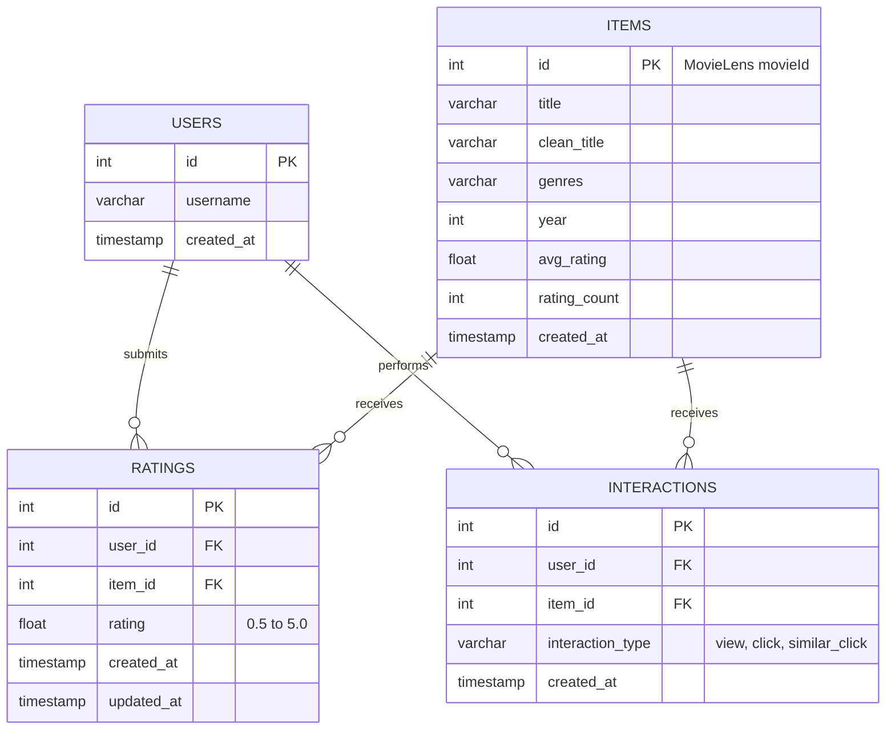
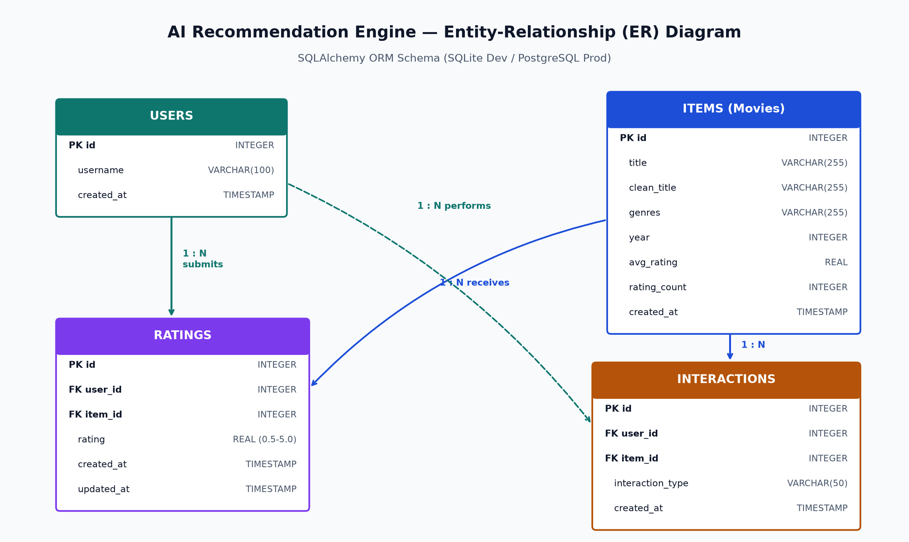

# Database Design & ER Diagram

**Engine:** SQLite (local development via SQLAlchemy) &rarr; Portable to PostgreSQL 16 + `pgvector` (production) via `DATABASE_URL` in `.env`.

---

## 1. Entity-Relationship (ER) Diagram

### Mermaid Diagram

### Rendered ER Diagram

---

## 2. Table Descriptions & Relationships

1. **`users`**
   - Stores user identities (`id` primary key, unique `username`, `created_at`).
   - One user can submit many `ratings` and perform many `interactions` (1-to-Many).
2. **`items`**
   - Stores cleaned movie metadata (`id` matching `movieId`, `title`, `clean_title`, `genres`, `year`) and pre-aggregated stats (`avg_rating`, `rating_count`).
   - One item can receive many `ratings` and many `interactions` (1-to-Many).
3. **`ratings`**
   - Stores explicit 0.5–5.0 user feedback linking `user_id` &rarr; `users.id` and `item_id` &rarr; `items.id`.
   - Indexed on `user_id` and `item_id` for fast per-user history and item aggregation lookups.
4. **`interactions`**
   - Tracks implicit user behavior (`view`, `click`, `similar_click`) for future collaborative filtering and evaluation.
